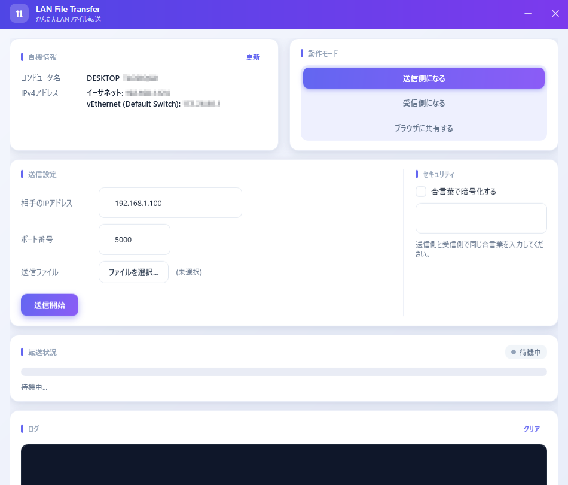
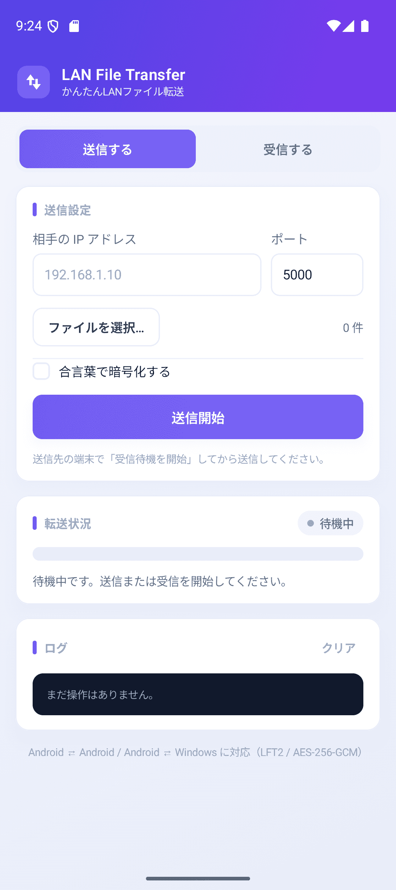

# Lan File Transfer (ローカルネットワーク内でファイル送受信)

[](https://opensource.org/licenses/MIT)
[](https://dotnet.microsoft.com/download/dotnet/8.0)
[](#動作要件)

LAN 内の Windows PC 同士で、ファイルをかんたんに送受信できるデスクトップアプリです。  
受信側にアプリを入れなくても、ブラウザで URL を開くだけで受け取れる「ブラウザ共有」も使えます。  



以下のようなシチュエーションを想定しています。
- クラウドなど外部サーバーを経由したくないファイルの送信
- インターネットに接続出来ないPCにファイルを送信
- USBが使えないPCからファイルを取り出す
- 大容量ファイルの送受信
- Windows-Android間でファイル送受信


## 特長

- **アプリ同士で送受信** — 送信側で選んだファイルを、受信側へ順番に送信
- **ブラウザ共有** — 受信側はアプリ不要。共有 URL をブラウザで開くだけ
- **接続元 IP の制限** — ブラウザ共有を許可する IP アドレス / 範囲を指定
- **合言葉による暗号化** — AES-256-GCM で通信を暗号化し、改ざんも検出
- **完全性検証** — 送受信したファイルの SHA-256 を照合
- **LAN 内で完結** — インターネット上のサーバーを経由しません
- **Android 版** — Android ⇄ Windowsで送受信できる[アプリ](https://github.com/OtabiHirohito/LanFileTransferForAndroid)を用意

## 目次

- [動作要件](#動作要件)
- [使い方](#使い方)
- [状態表示](#状態表示)
- [Android 版](#android-版)
- [セキュリティ](#セキュリティ)
- [ネットワーク設定](#ネットワーク設定)
- [トラブルシューティング](#トラブルシューティング)
- [通信プロトコル](#通信プロトコル)
- [開発](#開発)
- [ライセンス](#ライセンス)
- [寄付について](#寄付について)

## 動作要件

| 項目 | 内容 |
| --- | --- |
| OS | Windows 10 / 11 (64bit) |
| ランタイム | [.NET 8.0 Desktop Runtime](https://dotnet.microsoft.com/download/dotnet/8.0) |
| ネットワーク | 同一のローカルネットワーク(推奨:LANケーブルによる直結) |

## 使い方

### 受信側の PC

1. 動作モードで **「受信側になる」** を選択します。
2. **「フォルダを選択...」** で保存先を選びます。
3. 待受アドレス(すべて / 特定の IPv4)と待受ポート番号を確認します(既定: `5000`)。
4. 必要に応じて **「合言葉で暗号化する」** を ON にし、合言葉を入力します。
5. **「受信待機を開始」** をクリックします。
6. 画面に表示される自機の IPv4 アドレスを、送信側に伝えます。

### 送信側の PC

1. 動作モードで **「送信側になる」** を選択します。
2. 受信側の IP アドレスとポート番号を入力します。
3. **「ファイルを選択...」** で送信するファイルを選びます(複数選択可)。
4. 必要に応じて **「合言葉で暗号化する」** を ON にし、受信側と同じ合言葉を入力します。
5. **「送信開始」** をクリックします。

複数ファイルを選んだ場合は、一覧の順番に 1 ファイルずつ送信します。  
送信中に **「送信停止」** をクリックすると、途中で中止できます。  
受信側がまだ **「受信待機を開始」** していない場合は、最大 60 秒間 接続を再試行します。
その間に受信側で待機を開始すれば、自動的に送信が始まります。

### ブラウザで受け取る場合

受信側にアプリをインストールする必要はありません。

1. 送信側で動作モード **「ブラウザに共有する」** を選択します。
2. 共有アドレスと共有ポート番号を確認します(既定: `5000`)。
3. **「ファイルを選択...」** で共有するファイルを選びます(複数選択可)。
4. **「接続元IPの制限」** に、ダウンロードを許可する受信側の IPv4 アドレスを入力します(任意)。
5. **「セキュリティ」** 欄で共有のしかたを設定します。
   - **自動停止までの時間** — 10〜86400 秒(既定: 60 秒)
   - **URL にトークンを含める** — 既定 ON
   - **HTTPS で暗号化する** — 既定 ON
6. **「共有を開始」** をクリックします。
7. 表示された共有 URL(例: `https://192.168.1.10:5000/s/Ab12Cd34/`)を受信側に伝えます。
8. 受信側はその URL をブラウザで開き、ファイルをダウンロードします。

#### 受信ページの操作

- **ファイル名をクリック** — そのファイルだけをすぐにダウンロード
- **チェックボックス** — ダウンロードするファイルを選択
- **選択したファイルをダウンロード** — 選んだファイルを 1 ファイルずつまとめて取得
- **ZIP にまとめてダウンロード** — 選んだファイルを 1 つの ZIP として取得
- **全て選択 / 全て解除** — チェックを一括で切り替え

複数ファイルの一括ダウンロードでは、ブラウザが **「複数のファイルのダウンロード」** の許可を求める場合があります。  
保存されないときは許可するか、**「ZIP にまとめてダウンロード」** をお使いください。

#### 共有設定のポイント

- **共有アドレス** で特定の IPv4 を選ぶと、そのインターフェースからの接続だけを受け付けます。
  「すべてのアドレス」を選ぶと全インターフェースで待ち受け、URL も複数表示されます。
- **接続元 IP の制限** に IPv4 アドレスを入れると、そのアドレスからの接続だけを受け付けます。
  `192.168.1.20`(単一)や `192.168.1.0/24`(範囲)をカンマ区切りで複数指定できます。
  空欄にするとすべてのアドレスを許可します。許可されない接続には
  「アクセスが拒否されました」と表示され、送信側のログに接続元 IP が記録されます。
- 共有アドレスにはインターフェース名(例: `イーサネット: 192.168.1.10`)が表示されます。
- **Wi-Fi で共有する場合** や、**ネットワークが「パブリック」に設定されている場合** は、
  共有開始時に注意喚起の確認ダイアログが表示されます。
  トークンや HTTPS を OFF にした場合も、開始前に注意が表示されます。
- 共有は設定した時間(既定 **1 分**)で自動停止し、待ち受けポートも閉じます。
  ただし、**開始済みのダウンロードは時間を過ぎても完了まで続行** されます。
- **URL にトークンを含める** が ON のときは、URL 末尾のランダムな文字列を知っている人だけが
  ダウンロードできます。OFF にすると `https://192.168.1.10:5000/` のような URL になり、
  アドレスを知っている人は誰でもダウンロードできます。
- アプリの「合言葉」はブラウザ共有では使えません。
  ブラウザ共有では、セキュリティ欄がブラウザ共有用の設定に切り替わります。
- Windows ファイアウォールで、使用するポート(既定: `5000`)への受信許可が必要です。

### 状態表示

「転送状況」カードの右上に、現在の状態が色付きバッジで表示されます。  
動作中は点が点滅します。

| バッジ | 状態 |
| --- | --- |
| 待機中(グレー) | まだ送信 / 受信を開始していない |
| 送信中(青紫) | ファイルを送信中 |
| 接続待ち(青紫) | 受信側が受信待機を開始するのを待っている |
| 受信待機中(緑) | 接続を待ち受け中 |
| 受信中(水色) | ファイルを受信中 |

ブラウザ共有中は **「共有中」**、ブラウザへ送信中は **「送信中(ブラウザ)」** と表示されます。

## Android 版

Android 版は[こちら](https://github.com/OtabiHirohito/LanFileTransferForAndroid)です。
<p align="center">
  
</p>


- Android ⇄ Android / Android → Windows / Windows → Android に対応
- 合言葉による暗号化(AES-256-GCM)と SHA-256 の検証は Windows 版と同じ
- 画面を閉じてもフォアグラウンドサービスで受信を継続
- ブラウザ共有は Android 版にはありません(Windows 版専用)

使い方・ビルド方法は
[Android版README](https://github.com/OtabiHirohito/LanFileTransferForAndroid/README.md) をご覧ください。

## セキュリティ

### 合言葉による暗号化

「セキュリティ」欄で合言葉を設定すると、通信が **AES-256-GCM** で暗号化されます。

- 鍵は合言葉から **PBKDF2** で導出します(接続ごとにランダムなソルトを使用)。
- AES-GCM は暗号化と同時に改ざん検知も行うため、通信内容の改ざんは検出されます。
- **送信側・受信側の両方で同じ合言葉** を設定してください。
  設定が一致しない場合(片方だけ ON、合言葉違いなど)は接続が拒否され、
  送信側・受信側の両方に理由が表示されます(例: 「合言葉が一致しません」)。
- 合言葉は設定ファイルに保存されません。起動のたびに入力してください。

暗号化を使わない場合でも、**SHA-256 による完全性検証** は常に有効です。

### ブラウザ共有の保護

ブラウザ共有は、アプリ同士の暗号化プロトコルとは別物です。

- 共有 URL には共有のたびにランダムなトークンが入り、URL を知っている人だけがダウンロードできます
  (トークンは OFF にできます)。
- 共有は設定した時間(既定 1 分)で自動停止し、待ち受けポートも閉じます
  (開始済みのダウンロードのみ継続)。
- 共有アドレスを特定の IPv4 にすると、そのインターフェースからの接続だけに限定できます。
- **接続元 IP の制限** を設定すると、許可した IPv4 アドレス / 範囲以外からの接続を拒否できます
  (ブラウザ側の IP が DHCP などで変わると接続できなくなります)。
- Wi-Fi や「パブリック」ネットワークで共有を始めるときは確認ダイアログが表示されます。
- HTTPS を ON にすると、通信は **HTTPS(TLS)** で暗号化され、改ざんも検出されます。
  証明書は共有のたびに作る自己署名証明書のため、ブラウザに初回警告が表示されます。
- 送信できるのは、送信側で選んだファイルだけです(受信側から送り込むことはできません)。

#### 「セキュリティ保護なし」と表示される理由

HTTPS を ON にしていても、ブラウザの URL 欄に **「セキュリティ保護なし」** と表示されたり、
`https` に取り消し線が付いたりすることがあります。これはアプリの不具合ではありません。

ブラウザは HTTPS の安全性を、次の条件で判定しています。

1. 証明書が **信頼された認証局(CA)** から発行されているか
2. 証明書のホスト名 / IP が URL と一致するか
3. 有効期限が切れていないか

本アプリの証明書は、LAN の IP アドレス向けに共有のたびに作る **自己署名証明書** です。
信頼された CA の署名がないため、ブラウザは「相手を確認できない接続」と判断します。
その結果、警告を閉じたあとも「セキュリティ保護なし」の表示が残ります。

通信自体は TLS で暗号化されていますが、ブラウザがサーバーの身元を確認できていないため、
**能動的ななりすまし(中間者攻撃)までは防げない** 状態です。
共有 URL の推測できないトークンが、事実上の保護になっています。

### 実装している防御(受信側)

ネットワークから届く不正なデータで受信機能が止まったり、危険な書き込みをされたりしないよう、
次の対策を入れています。

- **待受アドレスの限定** — 公開したくないインターフェース(Wi-Fi 等)からの接続を遮断
- **ヘッダ検証** — マジック値・ファイル名長・ファイルサイズが異常な接続を拒否
- **ディスク枯渇対策** — ファイルサイズ上限(100 GiB)と保存先の空き容量チェック
- **タイムアウト** — 無通信の接続はハンドシェイク 30 秒 / ヘッダ・本体 60 秒で自動切断
- **受信ループの継続** — 1 件の受信に失敗しても受信待機は継続(エラーはログに表示)
- **ファイル名の無害化** — `..` やパス区切り、予約デバイス名、長すぎる名前を除去
- **不完全ファイルの削除** — 途中で失敗したファイルやハッシュ不一致のファイルは自動削除

### 既知の制限(仕様)

- 合言葉を設定 **しない** 場合、通信は平文です。盗聴・なりすまし対策には合言葉の設定を推奨します。
- 合言葉は接続ごとに使い捨てのセッションとして扱う簡易方式で、
  公開鍵基盤(PKI)による厳密な相手認証ではありません。
- 受信ポートを開いている間は誰でも接続を試みられます(合言葉で保護)。
- ブラウザ共有は既定で 1 分間だけ公開されます(時間は変更できます)。
  合言葉は使えません。HTTPS を OFF にすると平文、トークンを OFF にすると
  アドレスを知っている人は誰でも取得できます。
- ブラウザ共有で HTTPS を ON にした場合も、自己署名証明書のためブラウザに警告が表示されます。
- 接続元 IP の制限は IPv4 のみ対応です(IPv6 アドレスからの接続は許可されません)。
- 社内 LAN や自宅 LAN など、信頼できるネットワーク内での利用を想定しています。

## ネットワーク設定

- PC 同士を直結する場合、DHCP サーバーが存在しないため、
  各 PC の IPv4 アドレスとサブネットマスクは手動で固定設定してください。
- Windows ファイアウォールで、使用するポート(既定: `5000`)への受信を許可する必要があります。
- 待受アドレスを「すべてのアドレス」にすると、複数のネットワークインターフェースで待ち受けます。
  公開範囲を限定したい場合は、使用する IPv4 を選んでください。
- 共有 URL は、受信側から到達できるアドレスである必要があります。
  別のネットワークにいる場合は、VPN やルーティングの設定を確認してください。

## トラブルシューティング

### 受信側に接続できない

- 送信側と受信側の IP アドレス・ポート番号が合っているか確認してください。
- 受信側が **「受信待機を開始」** になっているか確認してください。
  送信側は受信待機が始まるまで最大 60 秒待ちます。60 秒を過ぎると接続エラーになります。
- Windows ファイアウォールで、使用するポートの受信が許可されているか確認してください。
- 待受アドレスが特定の IPv4 になっている場合、そのアドレスに到達できるか確認してください。
- 両方のアプリが同じバージョンか確認してください。

### 「合言葉が一致しません」と表示される

- 送信側・受信側の両方で **「合言葉で暗号化する」** が ON になっているか確認してください。
- 合言葉が完全に同じか確認してください(大文字・小文字、全角・半角、前後の空白)。
- 片方だけ古いバージョンの場合は、両方を最新版にしてください。

### ブラウザに証明書の警告が出る

自己署名証明書を使用しているため、初回アクセス時に警告が表示されます。  
**「詳細設定」→「(安全でない) ～に進む」** で続行するとダウンロードできます。  
URL 欄の「セキュリティ保護なし」表示については
[「セキュリティ保護なし」と表示される理由](#セキュリティ保護なしと表示される理由)をご覧ください。

### ブラウザに「アクセスが拒否されました」と表示される

送信側の **「接続元IPの制限」** に、ブラウザ側の IPv4 アドレスが含まれているか確認してください。

- 空欄にすると、すべてのアドレスを許可します。
- 単一 IP(`192.168.1.20`)または CIDR(`192.168.1.0/24`)で指定できます。
- 同じ PC のブラウザで動作確認する場合は、`127.0.0.1` も追加してください。
- ブラウザ側の IP が DHCP などで変わっていないか確認してください。

### 複数ファイルのダウンロードが保存されない

ブラウザの設定で、複数のファイルのダウンロードがブロックされている可能性があります。

- ブラウザの **「複数のファイルのダウンロード」** を許可する
- または **「ZIP にまとめてダウンロード」** を使う

### ポート番号が使用中になる

ほかのアプリが同じポートを使っている可能性があります。  
共有ポート / 待受ポートを別の番号(例: `5001`)に変更してください。

### 共有が終了してダウンロードできない

共有には有効期限があります(既定: 1 分)。  
送信側でもう一度共有を開始し、新しい URL を開いてください。  
開始済みのダウンロードは、期限が切れても完了まで続行されます。

### 大きなファイルのダウンロードが途中で止まる

- 送信側のアプリを終了しないでください。
- ネットワークが切断されていないか確認してください。
- 保存先の空き容量を確認してください。
- ブラウザ共有の場合は、時間切れになる前にダウンロードを開始してください。

## 通信プロトコル

アプリ同士の転送は、1 回の接続につきファイル 1 つを送る自作プロトコルです。

```text
[ハンドシェイク]
  送信→受信: 4byte マジック('LFT2') + 1byte フラグ(bit0=暗号化) (+16byte ソルト)
  受信→送信: 1byte ステータス(0=OK, 1=拒否) (+ 拒否理由 / 暗号化時の 32byte 鍵確認値)
[4byte: ファイル名の UTF8 バイト長 (Int32)]
[ファイル名 (UTF8)]
[8byte: ファイルサイズ (Int64)]
[ファイル本体データ]
[32byte: 本体の SHA-256 ハッシュ]
```

- 合言葉を設定した場合、ハンドシェイク以降は AES-256-GCM で
  「書き込み単位」を 1 レコード `[4byte 長][暗号文][16byte タグ]` として暗号化します。
- ハンドシェイクは双方向です。受信側は合言葉設定の不一致を理由付きで送り返し、
  合言葉が一致するかは鍵確認値(HMAC)で **本文を送る前** に検証します。
  そのため送信側にも「合言葉が一致しません」など具体的な原因が表示されます。
- 本体の SHA-256 は送信しながら計算し、最後に送って受信側で照合します。
  不一致の場合は受信ファイルを削除し、エラーとしてログに表示します。

ブラウザ共有を使う場合は、この独自プロトコルではなく
`http(s)://送信側IP:ポート/s/トークン/`(トークンは任意、期限付き)で配信します。

## 開発

### ビルド方法

1. [Visual Studio 2022](https://visualstudio.microsoft.com/ja/vs/) または
   [.NET 8 SDK](https://dotnet.microsoft.com/download/dotnet/8.0) をインストールします。
2. リポジトリをクローンします。

   ```bash
   git clone https://github.com/OtabiHirohito/LanFileTransfer.git
   ```

3. ソリューションファイル `LanFileTransfer.sln` を開いてビルドするか、
   コマンドラインで以下を実行します。

   ```bash
   dotnet build
   ```

4. 実行する場合は以下を実行します。

   ```bash
   dotnet run --project LanFileTransfer
   ```

### プロジェクト構成

```text
LanFileTransfer/
├─ MainWindow.xaml / MainWindow.xaml.cs   画面と共通処理
├─ MainWindow.Send.cs                     送信側の操作
├─ MainWindow.Receive.cs                  受信側の操作
├─ MainWindow.Settings.cs                 設定の保存・復元、アドレス選択
├─ MainWindow.Status.cs                   状態バッジ・進捗表示
├─ MainWindow.BrowserShare*.cs            ブラウザ共有の開始・停止・設定・表示
├─ BrowserShareServer*.cs                 HTTP/HTTPS サーバー
│  ├─ BrowserShareServer.cs               待ち受け・TLS・接続処理
│  ├─ BrowserShareServer.Routing.cs       リクエスト解析・認証・振り分け
│  ├─ BrowserShareServer.Downloads.cs     ファイル / ZIP 配信
│  ├─ BrowserShareServer.Responses.cs     レスポンスヘッダ
│  └─ BrowserShareServer.Pages.cs         受信ページ(HTML / JavaScript)
├─ FileTransferService.cs                 アプリ同士の送受信
├─ SecureChannel.cs                       ハンドシェイク・暗号化
├─ TransferProtocol.cs                    転送フォーマット
├─ SafeFileStore.cs                       保存先の安全な扱い
├─ BrowserShareCertificate.cs             自己署名証明書の生成
├─ ClientAddressFilter.cs                 ブラウザ共有の接続元IP制限
├─ NetworkHelper.cs / NetworkProfileHelper.cs
├─ ShareWarnings.cs                       共有前の注意喚起
├─ AppSettings.cs                         設定ファイル
└─ Theme.xaml                             画面テーマ
```


### リリース

最新版は [GitHub Releases](https://github.com/OtabiHirohito/LanFileTransfer/releases) から
`LanFileTransfer.zip` をダウンロードできます。

1. ZIP ファイルを任意の場所に展開します。
2. 展開したフォルダー内の `LanFileTransfer.exe` を実行します。

## ライセンス

このプロジェクトは **MIT ライセンス** のもとで公開されています。  
詳細は [LICENSE.txt](LICENSE.txt) をご覧ください。

## 寄付について

このソフトを気に入っていただけた場合は、よろしければ以下の寄付先への支援をご検討ください。  
<sub>本ソフトおよび制作者はリンク先の組織とは一切関係がございません。</sub>

- [寄付先一覧](https://otabihirohito.github.io/DonationDirectory/)
- [ランダム寄付先](https://otabihirohito.github.io/DonationDirectory/random.html)

---

Created by 大度寛仁 / X (Twitter): [@OtabiHirohito](https://x.com/OtabiHirohito)
